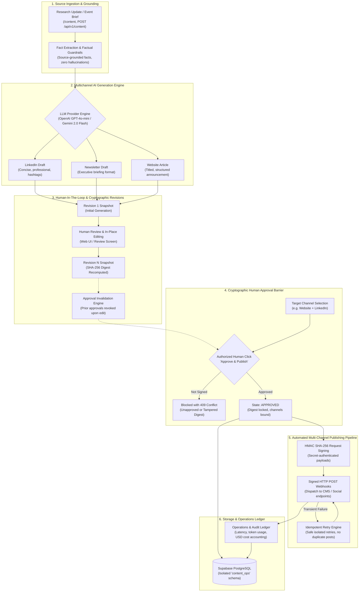

# AI Content Generation & Automated Publishing Agent

An independent content-agent prototype that transforms research updates, project announcements, and event notes into three source-grounded drafts (LinkedIn, Newsletter, and Website), tracks cryptographic revisions, enforces human approval before publishing, and demonstrates delivery through a signed local test publisher.

---

## Architecture Overview



---

## Key Features

1. **Fact-Grounded Multichannel Drafting**:
   - Transforms a single input source into three distinct, tailored drafts:
     - **LinkedIn**: Short, engaging, professional post with relevant community hashtags.
     - **Newsletter**: Concise executive briefing and progress summary for stakeholders.
     - **Website**: Formal, structured article with descriptive headers and paragraphs.
   - Source references help reviewers check factual statements; model output still requires human verification.
2. **Project Continuity & Follow-Up Awareness**:
   - Manages weekly progress updates for ongoing research projects and tracks cumulative milestones.
   - Contextually recalls prior achievements in the research series so subsequent posts build accurately on established narrative trajectories without repeating or contradicting past accomplishments.
3. **Block-Level Citations & Zero Hallucination**:
   - Maps every generated assertion or block of words to its exact source quote, URL, and category (`source_brief`, `past_post`, `scraped_link`, `web_search`).
   - Gives reviewers direct evidence and confidence to verify and trust the generated content.
4. **Given Link Inspection & Web Search Retrieval**:
   - Automatically detects and scrapes clean text content from URLs provided in the source brief.
   - Executes live web searches for relevant external facts when enabled, integrating the retrieved evidence into the grounded source context.
5. **Cryptographic Revision Management**:
   - Every edit creates an immutable snapshot with an incremented revision number and SHA-256 digest.
   - Any modification or change in channel selection immediately invalidates prior approvals, requiring re-approval.
   - Reviewer rejections are recorded with justification and block publication.
6. **Mandatory Human Approval Gate**:
   - Outbound publication is impossible without explicit, cryptographic human sign-off.
   - Direct API attempts without approval return `409 Conflict`.
7. **Automated Multi-Channel Publishing**:
   - Dispatches signed HTTP POST requests using HMAC SHA-256 authentication.
   - Tracks per-channel status (`published`, `failed`), external IDs, live URLs, timestamps, and retry counts (`attempts: 1/3`).
   - Idempotent execution protects against duplicate posts on retry or transient network errors.
8. **Operations & Cost Accounting Ledger**:
   - Sanitized timeline correlating requests, run IDs, latency (ms), model token counts, and estimated costs down to fractions of a cent ($0.10/M tokens).
9. **Authoritative Cloud Persistence**:
   - Backed by Supabase PostgreSQL in an isolated `content_ops` schema with Row Level Security (RLS) enabled.

---

## Quickstart

### Prerequisites
- Python 3.12 or 3.13
- [`uv`](https://docs.astral.sh/uv/) package manager
- Supabase PostgreSQL instance (or compatible PostgreSQL database)

### 1. Install Dependencies
```powershell
uv sync --locked
```

### 2. Configure Environment
Copy `.env.example` to `.env` and fill in your configuration:
```powershell
Copy-Item .env.example .env
```

### 3. Initialize Database Schema
Run the database setup script to create the `content_ops` PostgreSQL schema and tables:
```powershell
uv run python -m scripts.setup_db
```

### 4. Start the Application & Publisher

Run the two services in separate terminal windows:

**Terminal 1 — Content Agent Dashboard & API (Port 8001):**
```powershell
uv run uvicorn app.main:app --host 127.0.0.1 --port 8001
```

**Terminal 2 — Multichannel Publisher Service (Port 8011):**
```powershell
uv run uvicorn app.publisher:app --host 127.0.0.1 --port 8011
```

Open [http://127.0.0.1:8001](http://127.0.0.1:8001) in your browser.  
Sign in using the `REVIEWER_TOKEN` configured in your `.env` file.

---

## Production Environment Variables Reference

All application settings are managed in `.env` using standard names:

| Variable | Type | Allowed Values / Format | Default | Description |
|---|---|---|---|---|
| `MODE` | string | `cloud`, `demo` | `cloud` | Operational mode. Set to `cloud` for Supabase PostgreSQL. |
| `DATABASE_URL` | string | `postgresql+psycopg://...` | *Required* | Supabase pooled PostgreSQL URL with `postgresql+psycopg://`. All tables live in `content_ops` schema. |
| `REVIEWER_TOKEN` | string | String (min 24 characters) | *Required* | Secret token used by reviewers to log into the web dashboard and for Bearer token API authorization. |
| `SESSION_SECRET` | string | String (min 24 characters) | *Required* | Secret key used to sign `content_session` HTTP cookies. |
| `SECURE_COOKIES` | boolean | `true`, `false` | `false` (local) / `true` (prod) | Whether to enforce `Secure` flag on session cookies (set `true` when hosted behind HTTPS). |
| `LOCAL_DATA_DIR` | path | Directory path | `data` | Local directory for storing local logs or cache. |
| `PROVIDER` | string | `openai`, `gemini`, `xai` | `openai` | AI drafting provider (`openai`, `gemini`, or `xai`). |
| `MODEL_NAME` | string | Model identifier | `gpt-4o-mini` | The specific model identifier to query (e.g. `gpt-4o-mini`, `gemini-2.0-flash`). |
| `OPENAI_API_KEY` | string | API key string | Optional | OpenAI API key (required if `PROVIDER=openai`). |
| `GOOGLE_API_KEY` | string | API key string | Optional | Google Gemini API key (required if `PROVIDER=gemini`). |
| `XAI_API_KEY` | string | API key string | Optional | xAI API key (required if `PROVIDER=xai`). |
| `PROVIDER_TIMEOUT`| integer | Seconds | `45` | Timeout in seconds for LLM provider API requests. |
| `MAX_LLM_CALLS` | integer | `1`, `2`, `3` | `3` | Maximum automated LLM attempts permitted per generation run. |
| `MAX_JOB_COST_USD`| decimal string | Numeric string (e.g. `0.10`) | `0.10` | Hard cost ceiling per drafting job. |
| `MAX_INPUT_TOKENS`| integer | Number of tokens | `32000` | Maximum input token limit permitted per drafting call. |
| `INPUT_USD_PER_MILLION` | decimal string | Rate in USD | `0.10` | Provider pricing rate per 1M input tokens for cost calculation. |
| `OUTPUT_USD_PER_MILLION`| decimal string | Rate in USD | `0.40` | Provider pricing rate per 1M output tokens for cost calculation. |
| `PRICING_SOURCE_URL` | string | URL string | `https://ai.google.dev/pricing` | Documented source URL for token pricing rates. |
| `PRICING_CHECKED_AT` | string | Date string (`YYYY-MM-DD`) | `2026-10-21` | Date when token pricing was checked. |
| `PUBLISHER_URL` | string | URL string | `http://127.0.0.1:8011` | Destination URL of the publishing service. |
| `PUBLISHER_SECRET` | string | Secret string | *Required* | Shared HMAC SHA-256 secret key for signing outbound publication payloads. |
| `TRACING_BACKENDS` | string | `none`, `langfuse`, `langsmith`, `both` | `none` | External LLM observability export. Keep `none` to use internal database audit feed without cloud tracing. |

---

## Core API Endpoints Reference

All endpoints under `/api/v1` require `Authorization: Bearer <REVIEWER_TOKEN>`:

| Method | Endpoint | Description |
| :--- | :--- | :--- |
| `POST` | `/api/v1/content` | Generate three tailored drafts from a raw research brief (`source`). Returns content item ID, drafts, and initial revision digest. |
| `GET` | `/api/v1/content/{id}` | Retrieve content item, latest revision, and publication history. |
| `PUT` | `/api/v1/content/{id}` | Update drafts or selected channels; creates a new revision and recomputes SHA-256 digest, revoking prior approval. |
| `POST` | `/api/v1/content/{id}/reject` | Reviewer rejects the current revision with a justification reason; blocks publication. |
| `POST` | `/api/v1/content/{id}/approve-and-publish` | Explicit human sign-off with matching revision number and digest; triggers immediate signed HTTP publication. |
| `POST` | `/api/v1/content/{id}/retry` | Retry failed publication channels with bounded attempts and idempotency protection. |
| `GET` | `/api/v1/operations` | Retrieve correlated operations event feed and token usage records. |

---

## Verification & Testing

Run the full automated test suite:

```powershell
uv run python -m pytest
```
*Result: 29 passed (100%).*

Run linter checks:
```powershell
uv run ruff check .
```
*Result: All checks passed! 0 errors.*
